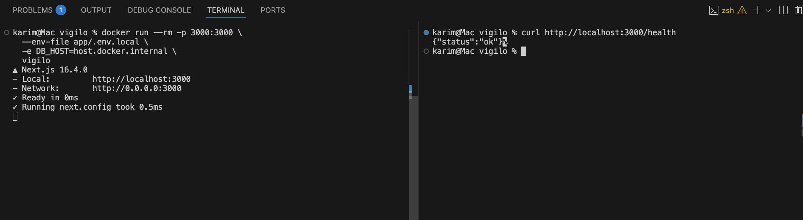
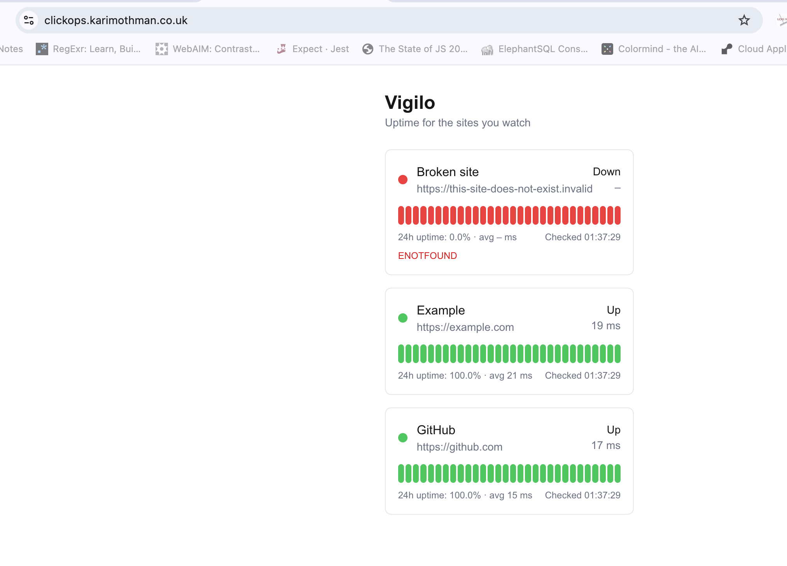
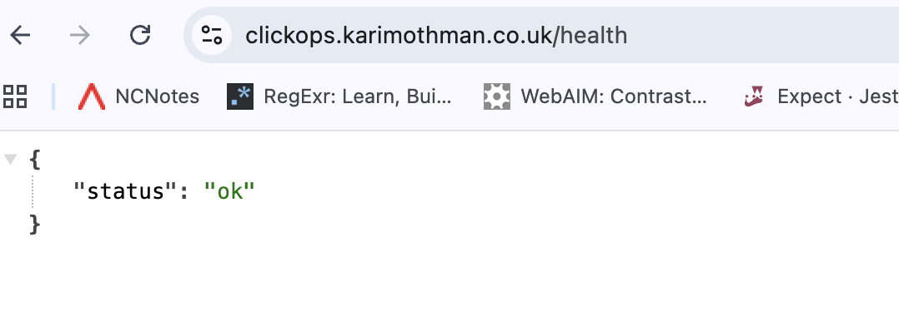

# Vigilo

Vigilo is an uptime monitor. It checks a list of websites every minute, stores each result in PostgreSQL, and shows current status, response times and 24-hour uptime on a dashboard.

I built the app myself and I'm deploying it to AWS on ECS Fargate. The deployment is done in stages: first by hand in the console, then rebuilt with Terraform, then fully automated with GitHub Actions.

**Status:** app, containers and ClickOps deployment are done. Terraform bootstrap and GitHub OIDC are done. The main infrastructure stack is in progress.

---

## Contents

- [How it works](#how-it-works)
- [Architecture](#architecture)
- [Running locally](#running-locally)
- [Container image](#container-image)
- [Stage 1: ClickOps deployment](#stage-1-clickops-deployment)
- [Stage 2: Terraform bootstrap and OIDC](#stage-2-terraform-bootstrap-and-oidc)
- [Repository structure](#repository-structure)
- [Roadmap](#roadmap)

---

## How it works

One container image, two processes:

| Process | Command | Job |
|---|---|---|
| web | `server.js` (default) | Next.js dashboard and API, port 3000 |
| worker | `worker.js` (overridden) | Runs DB migrations on start, then checks every site every 60s and writes the results |

The web and worker never talk to each other directly. They only share the database.

- `GET /health` returns `{"status":"ok"}`. It doesn't touch the database on purpose, so a database problem doesn't make the load balancer pull the web container out of service.
- `GET /api/sites` lists the monitored sites.
- `/` is the dashboard: latest status, last 30 checks, 24h uptime and average response time per site.

The worker creates its own tables on start (`CREATE TABLE IF NOT EXISTS`, seed rows with `ON CONFLICT DO NOTHING`), so a fresh database needs no manual setup. All SQL uses parameterised queries.

**Stack:** Next.js 16 (App Router), TypeScript, PostgreSQL 16, `pg`, Tailwind, Docker, AWS (ECS Fargate, ALB, RDS, ECR, ACM, Route 53, CloudWatch), Terraform, GitHub Actions.

---

## Architecture

Target design for the Terraform build:


- Custom VPC across two availability zones (`eu-west-2a`, `eu-west-2b`)
- Six subnets in three tiers:
  - **public:** ALB nodes and NAT gateways
  - **private app:** web and worker tasks
  - **private DB:** RDS
- One NAT gateway per AZ, so losing one zone doesn't cut the other zone off from the internet
- The DB subnets have no route to the internet at all
- HTTPS on the ALB with an ACM certificate; port 80 redirects to 443

**Route tables**

| Table | Routes |
|---|---|
| public | local, `0.0.0.0/0 → IGW` |
| app-a / app-b | local, `0.0.0.0/0 → NAT` in the same AZ |
| db | local only |

**Security groups**

| Group | Inbound | Why |
|---|---|---|
| alb-sg | 443, 80 from anywhere | Public entry point |
| web-sg | 3000 from alb-sg | Only the ALB can reach the web tasks |
| worker-sg | none | The worker never receives traffic |
| db-sg | 5432 from web-sg and worker-sg | Only the app can reach the database |

Web and worker get separate groups so the worker doesn't inherit an inbound rule it never uses.

---

## Running locally

Requirements: Docker with Compose.

```bash
cp .env.example .env          # set POSTGRES_PASSWORD
docker compose up -d --build
```

- Dashboard: http://localhost:3000
- Health check: http://localhost:3000/health
- Worker logs: `docker compose logs -f worker` (look for `Database ready`)

Compose runs three services: `db` (postgres:16 with a health check), `web` and `worker`. The app services wait until the database is healthy. `docker compose down` keeps the data; `docker compose down -v` wipes it.

---

## Container image



- **Multi-stage build:** dependencies, then build, then a small runtime image
- **Runtime base:** `gcr.io/distroless/nodejs24-debian13:nonroot`. It has no shell or package manager and runs as a non-root user.
- **Next.js standalone output:** only the files the server needs are copied in
- **Worker bundling:** the worker is bundled into one file with esbuild, so the same image can run either process
- **Platform:** built for `linux/amd64`, because Fargate runs x86 and I develop on an ARM Mac

```bash
docker buildx build --platform linux/amd64 -t vigilo .
```

Images go to Amazon ECR, tagged with the short git commit SHA. Tags are immutable, so a tag always points to the same build.

---

## Stage 1: ClickOps deployment

Before writing any Terraform, I built the whole stack by hand in the AWS console. That way I'd know what each resource does and how they connect. I served it at `clickops.karimothman.co.uk`, then tore it down.

| Dashboard | Health check |
|---|---|
|  |  |

**Problems I hit and how I fixed them**

1. **The VPC was greyed out when creating the ALB.** The default VPC had lost its internet gateway. I created and attached a new IGW and added a `0.0.0.0/0` route to it.
2. **The worker started the web server.** I'd typed `worker.js` into the container *health check* command instead of the container command, so the image ran its default `server.js`. I spotted it because the worker's logs showed Next.js boot lines.
3. **The dashboard showed `relation "checks" does not exist`.** The web task definition had no `DB_NAME`, so `pg` defaulted to the user name (`postgres`) and connected to an empty database, while the worker had built the tables in `vigilo`. This was config drift between two task definitions. The Terraform version defines the environment variables once and shares them.
4. **A service update didn't take effect.** The service was still on revision 1 of the task definition. I checked the Deployments tab, selected the new revision and forced a new deployment.

---

## Stage 2: Terraform bootstrap and OIDC

Before the pipeline can run, AWS needs a few things to exist: somewhere to keep Terraform state, and a way for GitHub Actions to log in. These live in their own Terraform root, `terraform/bootstrap`, with their own state.

**What bootstrap creates**

- **State bucket:**
  - Versioning, AES-256 encryption, all public access blocked
  - `prevent_destroy` so it can't be deleted by accident
- **GitHub OIDC provider:**
  - An existing one from an earlier project, imported into state rather than recreated
  - Also protected with `prevent_destroy`
- **Two IAM roles:**
  - `vigilo-github-plan`: can only be assumed by pull request workflows. Read-only, and can only write the state lock file.
  - `vigilo-github-apply`: can only be assumed by workflows on `main`. Can build the infrastructure.

**State**

- Bootstrap was first applied with local state.
- Then I added an S3 backend and ran `terraform init -migrate-state`, so bootstrap's own state lives in the bucket it created.
- Locking uses S3's native lock file (`use_lockfile = true`), so there's no DynamoDB table.

**No stored AWS credentials**

- GitHub Actions gets short-lived credentials through OIDC on every run.
- The role ARNs are stored as repository variables. They're identifiers, not secrets.
- Bootstrap was applied once from my laptop with a temporary IAM user, which I deleted once the first OIDC run passed.


**Least privilege for the apply role**

- I wrote the policy by hand: one statement per service, covering create, delete, modify and tag actions.
- **Scoped wherever AWS allows it:**
  - DNS changes only in my hosted zone
  - Logs and ECR only for resources named `vigilo*`
  - The role can only create IAM roles named `vigilo-ecs-*`, and only pass them to ECS tasks
  - Regional services are locked to `eu-west-2`
- **Explicit Deny statements:**
  - The role can't modify its own roles or the OIDC provider.
  - It can't delete the state bucket or change its versioning.
- The policy is split across two managed policies, because a single policy is capped at 6,144 characters.

**Problem I hit: OIDC trust kept failing**

- The first test run failed with `Not authorized to perform sts:AssumeRoleWithWebIdentity`.
- These all checked out: the trust policy, the provider, the branch, the repo name and the role ARN.
- **The cause:** GitHub had enabled *immutable subject claims* for the repo. The token's `sub` was `repo:K-Othman@<owner-id>/vigilo@<repo-id>:ref:refs/heads/main`, not `repo:K-Othman/vigilo:...`.
- I found it with `gh api repos/K-Othman/vigilo/actions/oidc/customization/sub`.
- I updated both trust policies to the ID-based format. This is also safer: if the repo were renamed or deleted, someone creating a new repo with the same name couldn't assume the roles.

**Reproducing bootstrap**

```bash
cd terraform/bootstrap
# needs admin credentials once (a temporary IAM user or AWS CloudShell)
terraform init
terraform apply
# then add the backend "s3" block and run:
terraform init -migrate-state
```

Copy the `apply_role_arn` and `plan_role_arn` outputs into GitHub under Settings → Secrets and variables → Actions → Variables, as `AWS_APPLY_ROLE_ARN` and `AWS_PLAN_ROLE_ARN`.

---

## Repository structure

```
vigilo/
├── app/                      # Next.js app and worker
│   └── src/
│       ├── app/              # dashboard, /health, /api/sites
│       ├── lib/              # db pool, migrations, site checker
│       └── worker/           # check loop
├── terraform/
│   ├── bootstrap/            # state bucket, OIDC, CI roles
│   └── infra/                # main stack (in progress)
├── .github/workflows/        # CI/CD
├── docs/screenshots/
├── Dockerfile
└── docker-compose.yml
```

---

## Roadmap

- [x] App with `/health`, worker and dashboard
- [x] Multi-stage distroless Docker image, local stack with Compose
- [x] Image pushed to ECR with SHA tags
- [x] Manual console deployment over HTTPS, then torn down
- [x] Terraform bootstrap: remote state, OIDC, least-privilege plan and apply roles
- [ ] Terraform infra: VPC, security groups, ACM, ALB, RDS, IAM, ECS, Route 53
- [ ] Pipelines: build and push image, plan on PR, apply on main, post-deploy health check
- [ ] Image scanning in CI
- [ ] CloudWatch alarms and log retention
- [ ] Architecture diagram and final screenshots