# Vigilo

Vigilo is an uptime monitor. It checks a list of websites every minute, stores each result in PostgreSQL, and shows current status, response times and 24-hour uptime on a dashboard.

I built the app myself and deployed it to AWS on ECS Fargate in stages: first by hand in the console, then rebuilt with Terraform, then fully automated with GitHub Actions.

**Live:** https://vigilo.karimothman.co.uk (only while the stack is up, since I destroy it when I'm not using it to save money)

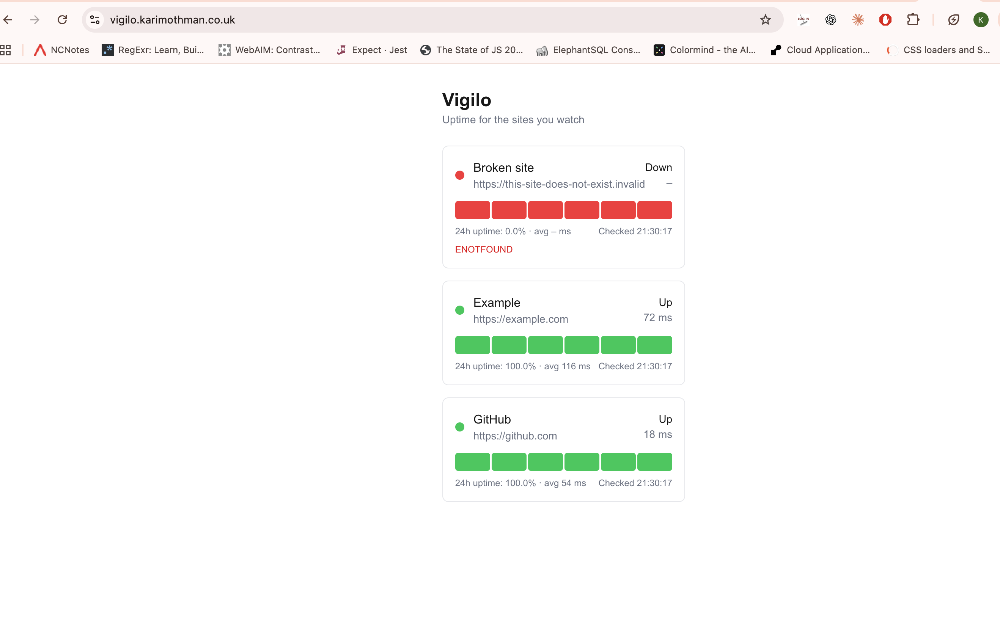

---

## Contents

- [How it works](#how-it-works)
- [Architecture](#architecture)
- [Running locally](#running-locally)
- [Container image](#container-image)
- [Stage 1: ClickOps deployment](#stage-1-clickops-deployment)
- [Stage 2: Terraform bootstrap and OIDC](#stage-2-terraform-bootstrap-and-oidc)
- [Stage 3: Terraform infrastructure](#stage-3-terraform-infrastructure)
- [Stage 4: CI/CD](#stage-4-cicd)
- [Key decisions](#key-decisions)
- [Known limitations](#known-limitations)
- [Repository structure](#repository-structure)
- [Roadmap](#roadmap)

---

## How it works

One container image, two processes:

| Process | Command | Job |
|---|---|---|
| web | `server.js` (default) | Next.js dashboard and API, port 3000 |
| worker | `worker.js` (overridden) | Runs DB migrations on start, then checks every site every 60s and writes the results |

The web and worker never talk to each other directly. They only share the database.

- `GET /health` returns `{"status":"ok"}`. It doesn't touch the database on purpose, so a database problem doesn't make the load balancer pull the web container out of service.
- `GET /api/sites` lists the monitored sites.
- `/` is the dashboard: latest status, last 30 checks, 24h uptime and average response time per site.

The worker creates its own tables on start (`CREATE TABLE IF NOT EXISTS`, seed rows with `ON CONFLICT DO NOTHING`), so a fresh database needs no manual setup. All SQL uses parameterised queries.

**Stack:** Next.js 16 (App Router), TypeScript, PostgreSQL 16, `pg`, Tailwind, Docker, AWS (ECS Fargate, ALB, RDS, ECR, ACM, Route 53, Secrets Manager, SSM, CloudWatch), Terraform, GitHub Actions, Trivy, TFLint.

---

## Architecture

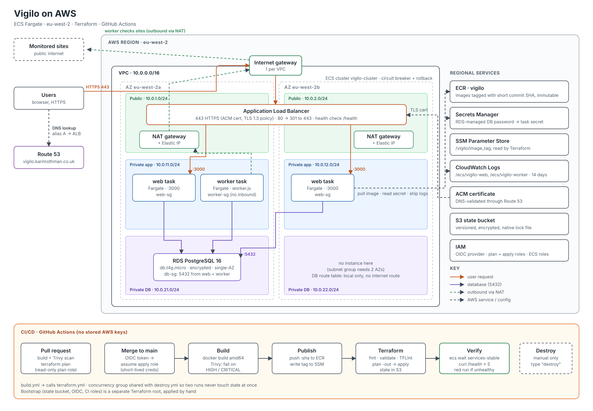

- Custom VPC (`10.0.0.0/16`) across two availability zones (`eu-west-2a`, `eu-west-2b`)
- Six subnets in three tiers:
  - **public** (`10.0.1.0/24`, `10.0.2.0/24`): ALB nodes and NAT gateways
  - **private app** (`10.0.11.0/24`, `10.0.12.0/24`): web and worker tasks
  - **private DB** (`10.0.21.0/24`, `10.0.22.0/24`): RDS
- One NAT gateway per AZ, so losing one zone doesn't cut the other zone off from the internet
- The DB subnets have no route to the internet at all
- HTTPS on the ALB with an ACM certificate (DNS-validated); port 80 redirects to 443
- Route 53 alias record points `vigilo.karimothman.co.uk` at the ALB

**Route tables**

| Table | Routes |
|---|---|
| public | local, `0.0.0.0/0 → IGW` |
| app-a / app-b | local, `0.0.0.0/0 → NAT` in the same AZ |
| db | local only |

**Security groups**

| Group | Inbound | Outbound | Why |
|---|---|---|---|
| alb-sg | 443, 80 from anywhere | VPC CIDR only | Public entry point |
| web-sg | 3000 from alb-sg | anywhere | Only the ALB can reach the web tasks |
| worker-sg | none | anywhere | The worker never receives traffic, but needs to reach the sites it checks |
| db-sg | 5432 from web-sg and worker-sg | none | Only the app can reach the database |

- Web and worker get separate groups so the worker doesn't inherit an inbound rule it never uses.
- Security groups are stateful, so the DB doesn't need an outbound rule to reply to the app.

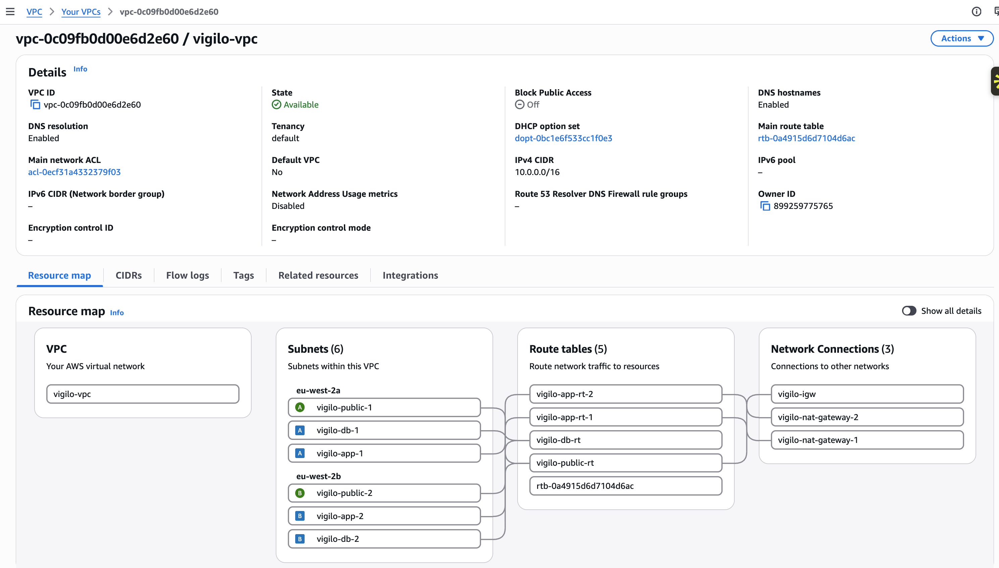

---

## Running locally

Requirements: Docker with Compose.

```bash
cp .env.example .env          # set POSTGRES_PASSWORD
docker compose up -d --build
```

- Dashboard: http://localhost:3000
- Health check: http://localhost:3000/health
- Worker logs: `docker compose logs -f worker` (look for `Database ready`)

Compose runs three services: `db` (postgres:16 with a health check), `web` and `worker`. The app services wait until the database is healthy. `docker compose down` keeps the data; `docker compose down -v` wipes it.

---

## Container image

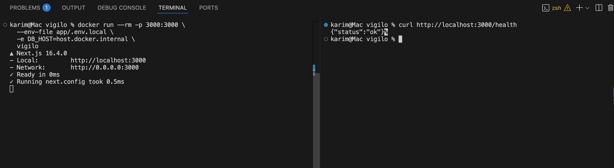

- **Multi-stage build:** dependencies, then build, then a small runtime image
- **Runtime base:** `gcr.io/distroless/nodejs24-debian13:nonroot`. It has no shell or package manager and runs as a non-root user.
- **Next.js standalone output:** only the files the server needs are copied in
- **Worker bundling:** the worker is bundled into one file with esbuild, so the same image can run either process
- **Platform:** built for `linux/amd64`, because Fargate runs x86 and I develop on an ARM Mac

```bash
docker buildx build --platform linux/amd64 -t vigilo .
```

Images go to Amazon ECR, tagged with the short git commit SHA. Tags are immutable, so a tag always points to the same build.

---

## Stage 1: ClickOps deployment

Before writing any Terraform, I built the whole stack by hand in the AWS console. That way I'd know what each resource does and how they connect. I served it at `clickops.karimothman.co.uk`, then tore it down.

| Dashboard | Health check |
|---|---|
| 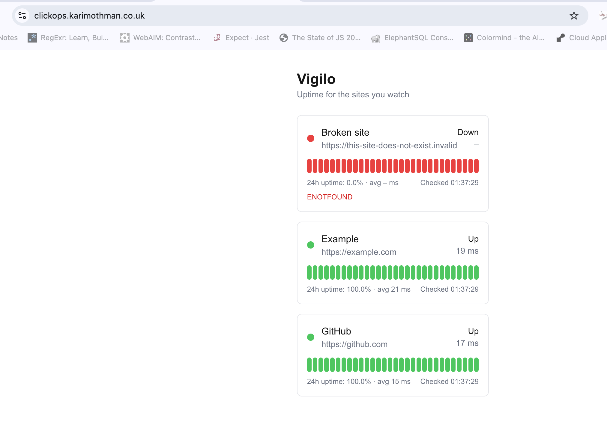 | 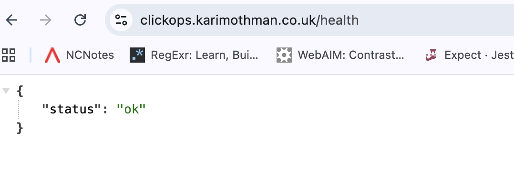 |

**Problems I hit and how I fixed them**

1. **The VPC was greyed out when creating the ALB.** The default VPC had lost its internet gateway. I created and attached a new IGW and added a `0.0.0.0/0` route to it.
2. **The worker started the web server.** I'd typed `worker.js` into the container *health check* command instead of the container command, so the image ran its default `server.js`. I spotted it because the worker's logs showed Next.js boot lines.
3. **The dashboard showed `relation "checks" does not exist`.** The web task definition had no `DB_NAME`, so `pg` defaulted to the user name (`postgres`) and connected to an empty database, while the worker had built the tables in `vigilo`. This was config drift between two task definitions. The Terraform version defines the environment variables once and shares them.
4. **A service update didn't take effect.** The service was still on revision 1 of the task definition. I checked the Deployments tab, selected the new revision and forced a new deployment.

---

## Stage 2: Terraform bootstrap and OIDC

Before the pipeline can run, AWS needs a few things to exist: somewhere to keep Terraform state, and a way for GitHub Actions to log in. These live in their own Terraform root, `terraform/bootstrap`, with their own state.

**What bootstrap creates**

- **State bucket:**
  - Versioning, AES-256 encryption, all public access blocked
  - `prevent_destroy` so it can't be deleted by accident
- **GitHub OIDC provider:**
  - An existing one from an earlier project, imported into state rather than recreated
  - Also protected with `prevent_destroy`
- **Two IAM roles:**
  - `vigilo-github-plan`: can only be assumed by pull request workflows. Read-only, and can only write the state lock file.
  - `vigilo-github-apply`: can only be assumed by workflows on `main`. Can build the infrastructure.

**State**

- Bootstrap was first applied with local state.
- Then I added an S3 backend and ran `terraform init -migrate-state`, so bootstrap's own state lives in the bucket it created.
- Locking uses S3's native lock file (`use_lockfile = true`), so there's no DynamoDB table.

**No stored AWS credentials**

- GitHub Actions gets short-lived credentials through OIDC on every run.
- The role ARNs are stored as repository variables. They're identifiers, not secrets.
- Bootstrap was applied once from my laptop with a temporary IAM user, which I deleted once the first OIDC run passed. Later bootstrap changes are applied from AWS CloudShell.

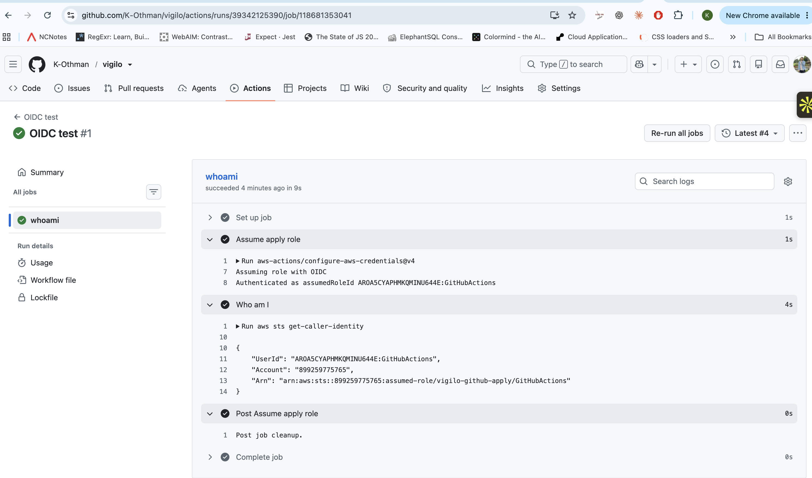

**Least privilege for the apply role**

- I wrote the policy by hand: one statement per service, covering create, delete, modify and tag actions.
- **Scoped wherever AWS allows it:**
  - DNS changes only in my hosted zone
  - Logs, ECR and SSM only for resources named `vigilo*`
  - The role can only create IAM roles named `vigilo-ecs-*`, and only pass them to ECS tasks
  - Regional services are locked to `eu-west-2`
- **Explicit Deny statements:**
  - The role can't modify its own roles or the OIDC provider.
  - It can't delete the state bucket or change its versioning.
- The policy is split across two managed policies, because a single policy is capped at 6,144 characters.

**Problem I hit: OIDC trust kept failing**

- The first test run failed with `Not authorized to perform sts:AssumeRoleWithWebIdentity`.
- These all checked out: the trust policy, the provider, the branch, the repo name and the role ARN.
- **The cause:** GitHub had enabled *immutable subject claims* for the repo. The token's `sub` was `repo:K-Othman@<owner-id>/vigilo@<repo-id>:ref:refs/heads/main`, not `repo:K-Othman/vigilo:...`.
- I found it with `gh api repos/K-Othman/vigilo/actions/oidc/customization/sub`.
- I updated both trust policies to the ID-based format. This is also safer: if the repo were renamed or deleted, someone creating a new repo with the same name couldn't assume the roles.

**Reproducing bootstrap**

```bash
cd terraform/bootstrap
# needs admin credentials once (a temporary IAM user or AWS CloudShell)
terraform init
terraform apply
# then add the backend "s3" block and run:
terraform init -migrate-state
```

Copy the `apply_role_arn` and `plan_role_arn` outputs into GitHub under Settings → Secrets and variables → Actions → Variables, as `AWS_APPLY_ROLE_ARN` and `AWS_PLAN_ROLE_ARN`.

---

## Stage 3: Terraform infrastructure

The main stack lives in `terraform/infra`, split into local modules. It's only ever applied by the pipeline, never from my laptop.

| Module | What it builds |
|---|---|
| `networking` | VPC, 6 subnets, IGW, 2 NAT gateways with Elastic IPs, 4 route tables |
| `security-groups` | The 4 groups above, using one resource per rule |
| `acm` | Certificate for `vigilo.karimothman.co.uk`, validated through Route 53 |
| `alb` | ALB, target group (`ip` targets on port 3000, health check on `/health`), HTTPS listener with a TLS 1.3 policy, HTTP → HTTPS redirect |
| `rds` | PostgreSQL 16 on `db.t4g.micro`, encrypted gp3 storage, private, password managed by RDS in Secrets Manager |
| `ecs` | Cluster, log groups (14-day retention), execution and task roles, two task definitions, two services |

Plus `dns.tf` in the root for the Route 53 alias record.

**ECS services**

- **web:** 2 tasks (one per AZ) behind the ALB, 60s health check grace period
- **worker:** 1 task, no load balancer, runs `worker.js`
- Both: 0.25 vCPU and 512 MB, private subnets, no public IP, deployment circuit breaker with automatic rollback
- The environment variables are defined once in a `locals` block and used by both task definitions, so the ClickOps `DB_NAME` drift can't happen again.
- The DB password is never in code or state. The task definition points at the RDS-managed secret (`valueFrom = "<secret-arn>:password::"`) and ECS injects it at start-up.
- No container health check: the image is distroless, so there's no shell or `curl` to run one. The ALB health check on `/health` does that job for web.

**Which image gets deployed**

- The build pipeline writes the new image tag to SSM Parameter Store (`/vigilo/image_tag`).
- Terraform reads it with a `data "aws_ssm_parameter"` block and builds the image URI from it.
- So a new deploy doesn't need a commit to change a tag in the Terraform code.

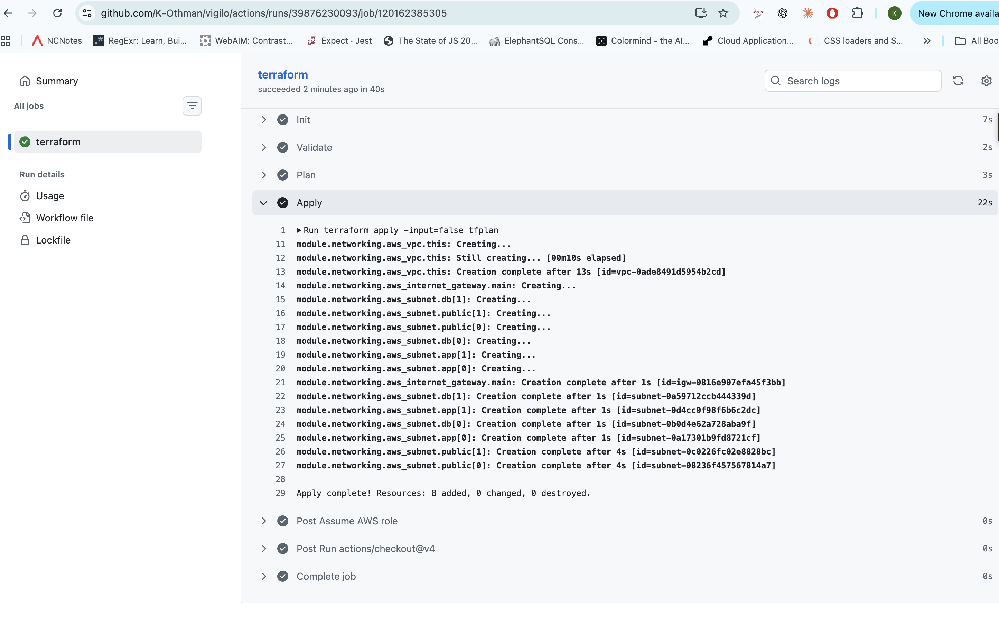

| Dashboard | Health check |
|---|---|
|  | 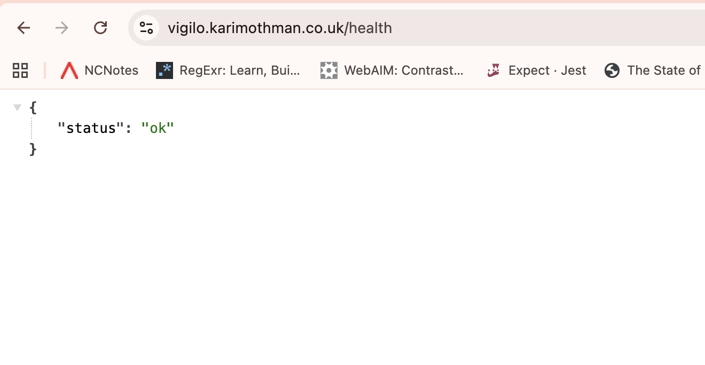 |

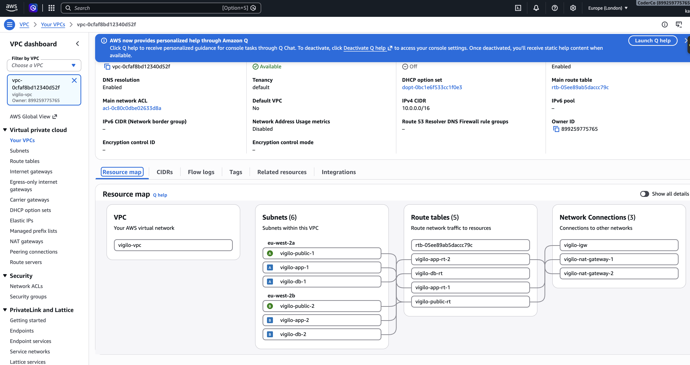

**Problems I hit and how I fixed them**

1. **The first ECS apply failed with "already exists".** The cluster and log groups from the ClickOps build were still there with the same names. I deleted them in the console and re-ran the pipeline. Lesson: clean up manual resources fully before Terraform takes over, or `import` them.
2. **Web and worker both timed out connecting to RDS (`ETIMEDOUT`).** The tasks were healthy, but the database never answered. Checking the RDS security group showed it was wearing the *ALB's* security group, not the DB one. The security group module's output was misnamed, and I'd passed `alb_sg_id` into the RDS module. I renamed the output to `db_sg_id`, fixed the wiring in `main.tf`, and the app connected straight away.
3. **`CannotPullContainerError`.** I'd left a placeholder tag in the image URI, so ECS was asking ECR for an image that didn't exist. This is what pushed me to read the tag from SSM instead of hardcoding it.
4. **The plan wanted to replace both task definitions on a run with no changes.** The tag in SSM didn't match the tag the running tasks used. I set SSM to the tag actually in ECR, and the plan went back to "No changes".

---

## Stage 4: CI/CD

Four workflows in `.github/workflows`:

| Workflow | Runs on | What it does |
|---|---|---|
| `build.yml` | changes to `app/`, `Dockerfile` | Build image, scan with Trivy, push to ECR, write tag to SSM, then call `terraform.yml` |
| `terraform.yml` | changes to `terraform/infra/`, or called by `build.yml` | fmt check, init, validate, TFLint, plan, then apply on `main` and check the deploy worked |
| `destroy.yml` | manual only | Tears down the whole infra stack |
| `oidc-test.yml` | manual only | Checks GitHub can still assume the AWS role |

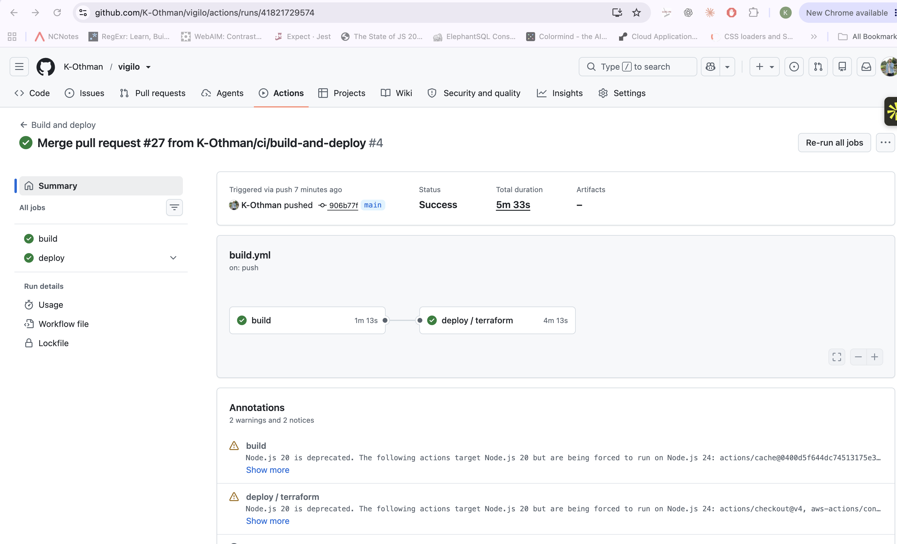

**On a pull request**

- `build.yml` builds the image and runs Trivy, but doesn't push anything.
- `terraform.yml` assumes the read-only plan role and runs a plan, so I can see the changes before merging.

**On merge to `main`**

1. Build the image for `linux/amd64`, tagged with the short commit SHA
2. Trivy scan. The job fails on any fixable HIGH or CRITICAL vulnerability.
3. Push to ECR and write the tag to SSM
4. `terraform plan -out=tfplan`, then `terraform apply tfplan`, so what gets applied is exactly what was planned
5. `aws ecs wait services-stable` waits until both services finish rolling out
6. `curl` the live `/health` endpoint, up to 5 tries, 15 seconds apart. If it never answers, the run goes red.

**Other details**

- `concurrency: terraform-infra` is shared by apply and destroy, so two runs can never touch the state at the same time.
- Destroy only runs from `main`, and only if you type `destroy` into the confirm box.
- `main` is protected: changes go through a pull request, force pushes and branch deletion are blocked.

**Trivy earned its place on the first run.** It failed the build on Next.js 16.4.0, which had two critical remote code execution CVEs and a high-severity denial of service. I upgraded to 16.4.1 and the scan passed. Without the scan, that version would have gone straight to production.

---

## Key decisions

- **Fargate, not EC2:** no instances to patch or scale. I only pay for the tasks.
- **NAT gateway per AZ:** costs more than one shared NAT, but one AZ going down doesn't take out the other's internet access.
- **Two Terraform roots:** bootstrap (state, OIDC, CI roles) changes rarely and is high-risk. Infra changes often. Keeping them apart means the pipeline can't break its own access.
- **OIDC instead of access keys:** nothing long-lived to leak or rotate.
- **Separate plan and apply roles:** PRs, including ones from branches I haven't reviewed yet, only get read access.
- **Image tag in SSM:** the build and Terraform stay in sync without commits that just bump a tag.
- **Immutable SHA tags:** every running task can be traced back to an exact commit.
- **RDS-managed password:** the password never appears in Terraform code, state or the task definition.
- **One resource per security group rule:** inline rules and separate rules fight each other in Terraform. Separate rules are easier to read and change.
- **Distroless image:** smaller attack surface. The trade-off is no container health check and no `exec` into the container for debugging.

---

## Known limitations

These are things I'd change for a real production system:

- **Data doesn't survive a destroy.** RDS uses `skip_final_snapshot` and the stack is destroyed when I'm not using it, so check history is lost. Fine for a demo, not for real use.
- **Single-AZ database.** `multi_az = false` to save money. An AZ outage would take the database down.
- **No required status checks on `main`.** The workflows use path filters, so a PR that only touches the README never triggers them. If I made them required, those PRs could never merge. A fix would be one always-running workflow that uses `dorny/paths-filter` to decide which jobs to run.
- **No approval step before apply.** Merging to `main` deploys straight away. A GitHub environment with required reviewers would add a manual gate.
- **Actions are pinned by version tag, not commit SHA.** A tag can be moved, so pinning by SHA is safer.
- **Only one worker.** Two workers would check every site twice. Scaling it would need locking or splitting the sites between workers.
- **No alarms yet.** Logs go to CloudWatch, but nothing alerts me if the site goes down or the worker stops.
- **The default VPC route table isn't managed by Terraform.**

---

## Repository structure

```
vigilo/
├── app/                      # Next.js app and worker
│   ├── public/               # static files (.gitkeep keeps it for the Docker COPY)
│   └── src/
│       ├── app/              # dashboard, /health, /api/sites
│       ├── lib/              # db pool, migrations, site checker
│       └── worker/           # check loop
├── terraform/
│   ├── bootstrap/            # state bucket, OIDC, CI roles
│   └── infra/                # main stack
│       └── modules/          # networking, security-groups, acm, alb, rds, ecs
├── .github/workflows/        # build, terraform, destroy, oidc-test
├── docs/                     # architecture diagram and screenshots
├── Dockerfile
└── docker-compose.yml
```

---

## Roadmap

- [x] App with `/health`, worker and dashboard
- [x] Multi-stage distroless Docker image, local stack with Compose
- [x] Image pushed to ECR with SHA tags
- [x] Manual console deployment over HTTPS, then torn down
- [x] Terraform bootstrap: remote state, OIDC, least-privilege plan and apply roles
- [x] Terraform infra: VPC, security groups, ACM, ALB, RDS, IAM, ECS, Route 53
- [x] Pipelines: build and push image, plan on PR, apply on main, post-deploy health check
- [x] Image scanning (Trivy) and Terraform linting (TFLint) in CI
- [x] Log retention
- [ ] CloudWatch alarms
- [ ] Manual approval before apply
- [ ] Pin actions by commit SHA